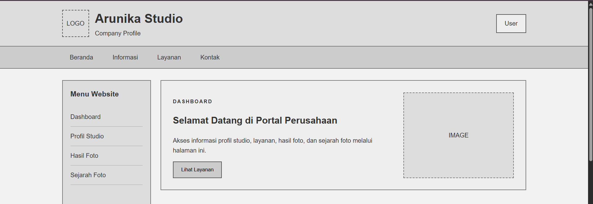
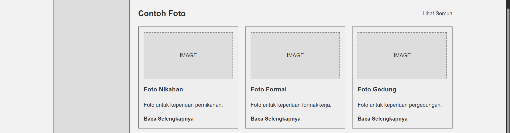
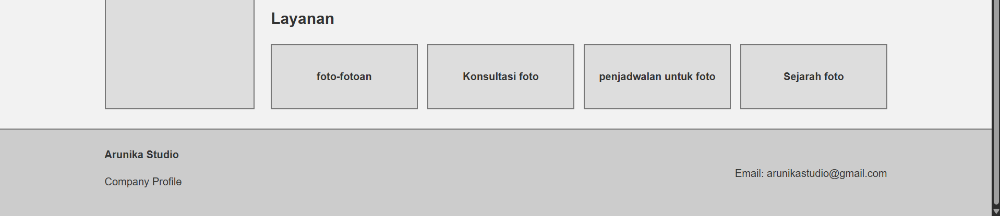
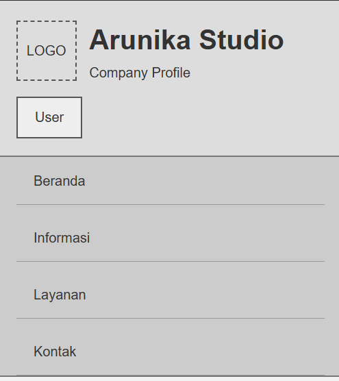
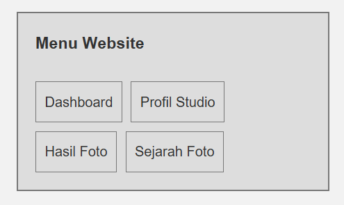
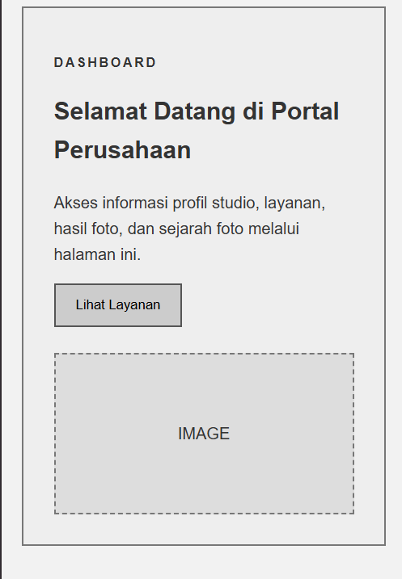
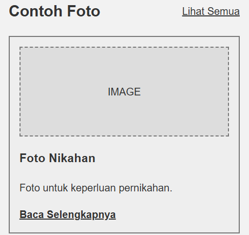
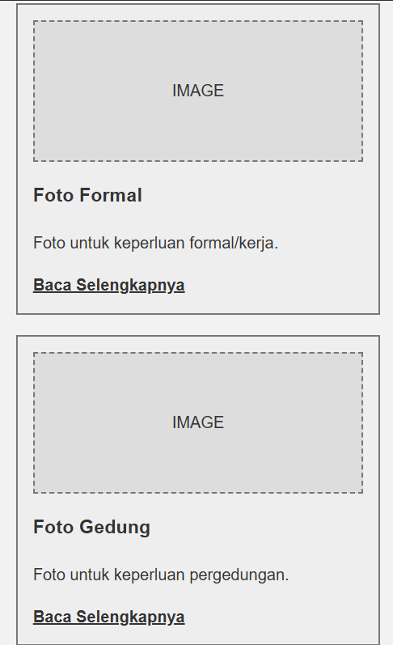
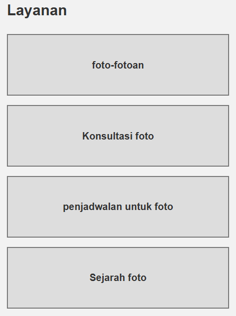
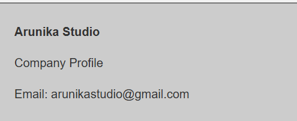

 LAPORAN PRAKTIKUM Desain Web

| Informasi Praktikan | Keterangan |
| :--- | :--- |
| **Nama** | I Gede Ardhika Arimbawa tangkas |
| **NPM** | 4525210080 |
| **Kelas** | A |
| **Mata Kuliah** | Desain Web |
| **Pertemuan** | 5 - Wireframe HTML |

# 1. Kesimpulan Kodingan

Proyek ini adalah wireframe halaman company profile “Arunika Studio”. Strukturnya terdiri dari header (logo placeholder dan profil user), navigasi, sidebar menu, hero, tiga kartu contoh foto, empat item layanan, dan footer. CSS memakai palet abu-abu khas wireframe, CSS Grid untuk tata letak utama, kartu, dan layanan, Flexbox untuk header, navigasi, dan footer, serta media query untuk tablet (900px) dan smartphone (600px). Penamaan class konsisten antara HTML dan CSS, dan kodenya terbaca rapi dengan komentar pembatas.

## 1.1 Masalah yang ditemukan

>Beberapa konten dalam file html tidak sesuai (typo dan kesalahan teks tidak seragam).

>Saran: Pastikan konten dalam file html diketik dengan cara yang benar.

# 2. Hasil Run

## 2.1 Desktop

**Hasil Run Header, Section Navigation, Sidebar, dan Section Hero/Dashboard:**

**Hasil Run Section Informasi/Contoh foto:**

**Hasil Run Section Layanan dan Footer:**

## 2.2 Mobile

**Hasil Run Header dan Section Navigation:**

**Hasil Run Section Sidebar:**

**Hasil Run Section Hero/Dasboard:**

**Hasil Run Section Informasi/Contoh foto Part 1:**

**Hasil Run Section Informasi/Contoh foto Part 2:**

**Hasil Run Section Layanan:**

**Hasil Run Footer:**

